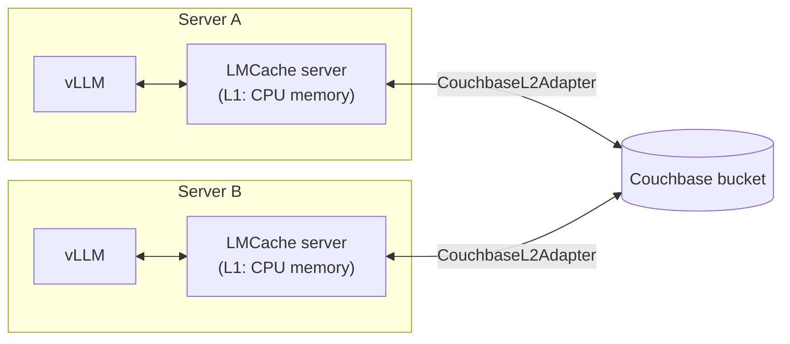

# Couchbase LMCache Connector

[](https://pypi.org/project/couchbase-lm-cache/)
[](https://pypi.org/project/couchbase-lm-cache/)
[](LICENSE)

`couchbase-lm-cache` lets [LMCache](https://github.com/LMCache/LMCache) keep the
KV cache of LLM prompts in Couchbase. Every vLLM server that points at the same
bucket can then reuse prompts another server already read, and keeps them across
restarts, instead of recomputing them on the GPU.

```bash
pip install couchbase-lm-cache
```

```bash
lmcache server --port 6555 --l1-size-gb 16 --l2-adapter \
  '{"type": "plugin", "module_path": "couchbase_lm_cache.l2_adapter",
    "class_name": "CouchbaseL2Adapter", "adapter_params": {"ttl_seconds": 86400}}'
```

## Contents

- [Why a shared KV cache](#why-a-shared-kv-cache)
- [How it works](#how-it-works)
- [Compatibility](#compatibility)
- [Installation](#installation)
- [Quickstart: Docker](#quickstart-docker)
- [Deployment guide](#deployment-guide)
- [Configuration reference](#configuration-reference)
- [Sizing](#sizing)
- [Storage format](#storage-format)
- [Operations](#operations)
- [Performance](#performance)
- [In-process mode](#in-process-mode-lmcacheconnectorv1)
- [Limitations and known issues](#limitations-and-known-issues)
- [Troubleshooting](#troubleshooting)
- [FAQ](#faq)
- [Python API](#python-api)
- [Development](#development)

## Why a shared KV cache

Before an LLM writes the first word of an answer, it reads the whole prompt and
turns every token into keys and values in each of its layers: the **KV cache**.
This step (*prefill*) takes GPU time that grows with the prompt, and the result
is large. For Qwen3-8B every token takes 144 KB (2 × 36 layers × 8 KV heads ×
128 values × 2 bytes), so a 10k-token prompt needs about 1.4 GB.

Chats and agents resend their whole context on every turn: instructions,
documents, tool output and all earlier turns. vLLM can reuse the KV cache of a
previous turn, but only while it is still in that GPU's memory. The turn has to
be read again when:

- **the next turn lands on another server** (load balancers rarely pin a session
  to one GPU),
- **the cache was evicted** in the meantime because other sessions needed the
  space (on a 24 GB GPU running an 8B model, about 3 GB is left for KV caches,
  room for two 10k-token contexts), or
- **the server restarted** or was scaled down.

LMCache moves KV caches off the GPU. This package adds Couchbase as the tier
behind LMCache's local CPU cache, so every server shares one cache that also
outlives restarts.

| | Without a shared cache | With Couchbase |
| --- | --- | --- |
| Next turn on another server | reads the whole context again | loads it from Couchbase |
| After a restart or scale-out | starts cold | starts warm |
| Cache capacity | GPU + local CPU memory of one server | the Couchbase bucket, shared |

## How it works



1. vLLM hands each prompt to its LMCache server. LMCache splits the tokens into
   chunks (256 tokens by default) and derives a key for each chunk from a hash
   of the tokens up to and including it, so the same text always gives the same
   keys and a chunk is only reused when everything before it matches too.
2. **Lookup.** The LMCache server asks its local CPU cache (L1) first, then
   Couchbase (L2), for the longest prefix of chunks it already has.
3. **Load.** Found chunks are read from Couchbase into L1 and handed to vLLM,
   which only computes the tokens after the last cached chunk.
4. **Store.** Newly computed chunks are written to L1 and, in the background,
   to Couchbase, where any other LMCache server can find them.

Each chunk is stored as plain key-value documents: no SQL++ queries, indexes,
embeddings or vector search are involved. Large chunks are split into 1 MB
documents that are read in parallel (see [Storage format](#storage-format)).

The package provides two plugins, one per LMCache architecture:

| LMCache architecture | Couchbase plugin | Status |
| --- | --- | --- |
| **Multiprocess (MP) mode**: a standalone `lmcache server` next to vLLM's `LMCacheMPConnector` | `couchbase_lm_cache.l2_adapter.CouchbaseL2Adapter` (L2 adapter) | **Recommended.** Verified end to end with vLLM 0.31 |
| In-process mode: vLLM's `LMCacheConnectorV1` | `couchbase_lm_cache.connector.CouchbaseConnector` (remote storage plugin) | Works, but affected by an upstream LMCache bug on vLLM ≥ 0.26 ([details](#in-process-mode-lmcacheconnectorv1)) |

## Compatibility

| Component | Tested | Supported |
| --- | --- | --- |
| LMCache | 0.5.6 (`lmcache/vllm-openai:v0.5.6` image) | ≥ 0.5.6 (MP mode L2 adapter API) |
| vLLM | 0.31.0 (bundled in the LMCache image) | 0.26+ with `LMCacheMPConnector` |
| Couchbase Server | 8.0.2 Enterprise | 7.x or later; Capella |
| Couchbase Python SDK | 4.6.3 | ≥ 4.6.3, < 5 |
| Python | 3.12 (LMCache image), 3.14 (unit tests) | ≥ 3.10 |

Models: anything vLLM and LMCache serve. Verified with Qwen3-8B and Qwen3-0.6B.

## Installation

Install the package in the same Python environment as the LMCache server:

```bash
pip install couchbase-lm-cache            # the connector (needs LMCache present)
pip install 'couchbase-lm-cache[lmcache]' # also pulls in lmcache>=0.5.6
```

On top of the official LMCache image, as in [`docker/Dockerfile`](https://github.com/Couchbase-Ecosystem/couchbase-lm-cache/blob/HEAD/docker/Dockerfile):

```dockerfile
FROM lmcache/vllm-openai:v0.5.6
RUN uv pip install --python /opt/venv/bin/python couchbase-lm-cache
```

Check that the plugin imports and reaches Couchbase without starting a model:

```bash
export LMCACHE_COUCHBASE_CONNSTR=couchbase://127.0.0.1
export LMCACHE_COUCHBASE_USERNAME=Administrator LMCACHE_COUCHBASE_PASSWORD=password
export LMCACHE_COUCHBASE_BUCKET=lmcache
python examples/store_smoke.py   # prints: Couchbase LMCache store smoke test passed
```

## Quickstart: Docker

[`docker/compose.yaml`](https://github.com/Couchbase-Ecosystem/couchbase-lm-cache/blob/HEAD/docker/compose.yaml) runs Couchbase Server and, for each
of two GPUs, an LMCache server with the Couchbase L2 adapter plus a vLLM server.
It needs Docker with GPU access through the NVIDIA Container Toolkit; GPUs are
requested by CDI name (`nvidia.com/gpu=0`), which recent toolkits configure
automatically (`nvidia-ctk cdi list`).

```bash
git clone https://github.com/Couchbase-Ecosystem/couchbase-lm-cache
cd couchbase-lm-cache
docker compose -f docker/compose.yaml up -d --build
# Couchbase UI: http://localhost:9091 (Administrator / password)
# vLLM A (GPU 0): http://localhost:8100   vLLM B (GPU 1): http://localhost:8200
python examples/vllm_e2e_demo.py
```

The demo sends a long, never-seen prompt to vLLM A, which computes it while its
LMCache server writes the KV cache to Couchbase. It then sends the same context
to vLLM B, which loads it from Couchbase, and finally recreates LMCache A and
vLLM A and checks that they reload it from Couchbase. It records time to first
token (TTFT), answers, first-token log-probabilities, LMCache log lines and
Couchbase stats in `evidence/e2e-*/`.

| Variable | Default | Purpose |
| --- | --- | --- |
| `MODEL` | `Qwen/Qwen3-0.6B` | Model served by both vLLM servers |
| `GPU_MEMORY_UTILIZATION` | `0.2` | vLLM's share of each GPU |
| `LMCACHE_L1_SIZE_GB` | `4` | LMCache server CPU cache |
| `COUCHBASE_RAM_MB` / `COUCHBASE_BUCKET_RAM_MB` | `4096` / `3072` | Couchbase node and bucket memory quota |

The 8B results below used:

```bash
export MODEL=Qwen/Qwen3-8B GPU_MEMORY_UTILIZATION=0.85 LMCACHE_L1_SIZE_GB=16
export COUCHBASE_RAM_MB=18432 COUCHBASE_BUCKET_RAM_MB=16384
docker compose -f docker/compose.yaml up -d --build
python examples/ttft_benchmark.py --prompts 5   # TTFT computed vs. loaded, before and after a restart
```

[`demo/`](https://github.com/Couchbase-Ecosystem/couchbase-lm-cache/blob/HEAD/demo) is a browser view of the same flow (requests, timings, raw
LMCache logs and live bucket stats).

[docs/demo.md](https://github.com/Couchbase-Ecosystem/couchbase-lm-cache/blob/HEAD/docs/demo.md) walks through the whole setup step by step: GPU
access for Docker, the stack, the checks, the benchmark, the browser demo and
recording the clips.

## Deployment guide

### 1. Prepare Couchbase

Use a dedicated bucket, or a dedicated collection in a shared bucket, for the
KV cache.

- **Bucket type.** An **ephemeral bucket** with `nruEviction` suits a cache
  that only needs to survive LMCache and vLLM restarts: it never writes to disk
  and evicts the least recently used documents when full. Use a regular
  Couchbase bucket if the cache must also survive Couchbase restarts.
- **Memory quota.** Size the bucket RAM quota for the KV cache you want served
  from memory ([Sizing](#sizing)). Documents evicted to disk in a Couchbase
  bucket are read back much more slowly.
- **Replicas.** Each replica costs the same memory again. A lost cache is only
  recomputed, so 0 replicas is reasonable unless you need failover.
- **User.** Create a user with the **Data Reader** and **Data Writer** roles on
  the bucket (or its scope/collection). No query or index roles are needed.
- **Capella.** Use the `couchbases://` connection string from the Capella UI and
  allow the LMCache servers' IP addresses. Keep LMCache close to the cluster:
  every load reads gigabytes.

```bash
# Self-managed example: an ephemeral bucket with a 16 GB quota and a cache user
couchbase-cli bucket-create -c localhost -u Administrator -p password \
  --bucket lmcache --bucket-type ephemeral --bucket-ramsize 16384 \
  --bucket-eviction-policy nruEviction --bucket-replica 0
couchbase-cli user-manage -c localhost -u Administrator -p password --set \
  --rbac-username lmcache --rbac-password '<secret>' --auth-domain local \
  --roles 'data_reader[lmcache],data_writer[lmcache]'
```

### 2. Install the package next to LMCache

See [Installation](#installation). Every LMCache server that should share the
cache needs it.

### 3. Configure the connection

Pass credentials through the environment so they stay off the command line and
out of process listings:

```bash
export LMCACHE_COUCHBASE_CONNSTR=couchbases://cb.example.cloud.couchbase.com
export LMCACHE_COUCHBASE_USERNAME=lmcache
export LMCACHE_COUCHBASE_PASSWORD='<secret>'
export LMCACHE_COUCHBASE_BUCKET=lmcache
```

Anything else can go in the adapter's `adapter_params` (next step) or in more
`LMCACHE_COUCHBASE_*` variables; see the
[Configuration reference](#configuration-reference).

### 4. Start the LMCache server with the Couchbase L2 adapter

```bash
lmcache server --port 6555 \
  --l1-size-gb 16 --eviction-policy LRU \
  --l2-adapter '{"type": "plugin",
                 "module_path": "couchbase_lm_cache.l2_adapter",
                 "class_name": "CouchbaseL2Adapter",
                 "adapter_params": {"ttl_seconds": 86400}}'
```

On start it logs `Couchbase L2 adapter ready: {...}` with the effective settings
(the password redacted). Give L1 room for several prompts: chunks loaded from
Couchbase are staged there, and if L1 is full LMCache silently recomputes
instead (see [Troubleshooting](#troubleshooting)).

### 5. Start vLLM with the LMCache MP connector

```bash
vllm serve Qwen/Qwen3-8B --kv-transfer-config \
  '{"kv_connector": "LMCacheMPConnector", "kv_role": "kv_both",
    "kv_connector_extra_config": {"lmcache.mp.port": 6555}}'
```

The LMCache server and vLLM must share the GPU and the IPC namespace: run them
on the same host, or in one Kubernetes pod / with
`network_mode: service:<lmcache>` and `ipc: host` in Compose, as in
[`docker/compose.yaml`](https://github.com/Couchbase-Ecosystem/couchbase-lm-cache/blob/HEAD/docker/compose.yaml). Follow LMCache's MP-mode
deployment guide for the details.

### 6. Add servers

Repeat steps 2–5 on every server. All LMCache servers that use the same bucket,
scope, collection and `key_prefix` share one cache. Servers that serve different
models never collide: the model name is part of every key.

## Configuration reference

Both plugins accept the same settings:

- **MP mode** (`CouchbaseL2Adapter`): fields in `adapter_params`.
- **In-process mode** (`CouchbaseConnector`): `remote_storage_plugin.couchbase.<field>`
  keys in LMCache's `extra_config`.
- **Either mode**: any field left out falls back to the environment variable
  `LMCACHE_COUCHBASE_<NAME>`.

| Field | Environment variable | Default | Description |
| --- | --- | --- | --- |
| `connection_string` | `LMCACHE_COUCHBASE_CONNSTR` | **required** | `couchbase://host` or `couchbases://host` (TLS, Capella) |
| `username` | `LMCACHE_COUCHBASE_USERNAME` | **required** | Database user |
| `password` | `LMCACHE_COUCHBASE_PASSWORD` | **required** | Its password; never logged |
| `bucket_name` | `LMCACHE_COUCHBASE_BUCKET` | **required** | Bucket that holds the cache |
| `scope_name` | `LMCACHE_COUCHBASE_SCOPE` | `_default` | Scope |
| `collection_name` | `LMCACHE_COUCHBASE_COLLECTION` | `_default` | Collection |
| `key_prefix` | `LMCACHE_COUCHBASE_KEY_PREFIX` | `lmcache:` | Prepended to every document key; servers share a cache only with the same prefix |
| `ttl_seconds` | `LMCACHE_COUCHBASE_TTL_SECONDS` | none | Expiry set on every document written; unset or `0` keeps documents until evicted or deleted |
| `shard_size_bytes` | `LMCACHE_COUCHBASE_SHARD_SIZE_BYTES` | `1048576` (1 MiB) | Chunks larger than this are split into documents of this size (1 byte to 20 MiB) |
| `kv_timeout_seconds` | `LMCACHE_COUCHBASE_KV_TIMEOUT_SECONDS` | `10` | Timeout per key-value operation |
| `connect_timeout_seconds` | `LMCACHE_COUCHBASE_CONNECT_TIMEOUT_SECONDS` | `10` | Timeout for connecting to the cluster |
| `max_workers` | `LMCACHE_COUCHBASE_MAX_WORKERS` | `32` | Concurrent Couchbase operations per LMCache server |

Examples:

```jsonc
// MP mode: everything in adapter_params (credentials still from the environment)
{"type": "plugin", "module_path": "couchbase_lm_cache.l2_adapter",
 "class_name": "CouchbaseL2Adapter",
 "adapter_params": {"bucket_name": "lmcache", "scope_name": "prod",
                    "collection_name": "kv", "key_prefix": "qwen3-8b-v1:",
                    "ttl_seconds": 86400, "max_workers": 32}}
```

```yaml
# In-process mode: LMCache YAML (LMCACHE_CONFIG_FILE)
remote_storage_plugins: [couchbase]
extra_config:
  remote_storage_plugin.couchbase.module_path: couchbase_lm_cache.connector
  remote_storage_plugin.couchbase.class_name: CouchbaseConnector
  remote_storage_plugin.couchbase.bucket_name: lmcache
  remote_storage_plugin.couchbase.ttl_seconds: 86400
```

LMCache does not expand `${VAR}` placeholders in its YAML, so keep secrets in
the environment variables.

## Sizing

**KV cache per token** is fixed by the model architecture and data type:

```
bytes per token = 2 (key + value) × layers × KV heads × head size × bytes per value
```

| Model | Per token (16-bit) | 10k-token context |
| --- | --- | --- |
| Qwen3-0.6B (28 layers, 8 KV heads, 128) | 112 KB | 1.1 GB |
| Qwen3-8B (36 layers, 8 KV heads, 128) | 144 KB | 1.4 GB |
| Llama 3.1 8B (32 layers, 8 KV heads, 128) | 128 KB | 1.2 GB |
| Llama 3.1 70B (80 layers, 8 KV heads, 128) | 320 KB | 3.05 GB |

Hybrid and compressed-attention models (for example Qwen3.8, Kimi K3, GLM-5.3)
keep less per token; compute it from their `config.json`. An 8-bit KV cache
(`--kv-cache-dtype fp8` in vLLM) halves these numbers.

**Documents.** LMCache stores full chunks of `chunk_size` tokens (256 by
default). Each chunk is `chunk_size × bytes per token`, stored as
`ceil(chunk / shard_size_bytes)` shard documents plus one manifest. For
Qwen3-8B a chunk is 36 MB: 36 shards + 1 manifest = 37 documents, so a
10,288-token context becomes 40 chunks and 1,480 documents. The last partial
chunk (48 tokens here) is not stored and is always recomputed.

**Bucket memory.** Plan for the contexts you want served from memory, plus
Couchbase's per-document overhead (well under 1% at 1 MB documents) and
replicas: `quota ≈ contexts × tokens × bytes per token × (1 + replicas)`. For
example, 1,000 sessions of 10k tokens on Qwen3-8B is about 1.4 TB; size the
cluster or set `ttl_seconds` so that idle sessions expire.

**LMCache L1.** The LMCache server stages every chunk it loads from Couchbase in
its CPU cache (`--l1-size-gb`). Leave room for several concurrent contexts,
about 1.5 GB per 10k-token context on an 8B model.

## Storage format

**MP mode** (`CouchbaseL2Adapter`) stores each LMCache object under

```
<key_prefix><model>@0x<kv_rank:08x>@<object_group_id:x>@<chunk_hash>[@<cache_salt>]
```

the same layout as LMCache's built-in L2 adapters, holding the raw chunk bytes.

**In-process mode** (`CouchbaseConnector`) stores each chunk under
`<key_prefix><CacheEngineKey.to_string()>`. With LMCache's default
`save_chunk_meta`, the document is LMCache's serialized `RemoteMetadata` header
followed by the chunk bytes, so partial chunks round-trip exactly.

**Sharding (both modes).** A payload larger than `shard_size_bytes` is written
as binary documents `<key>::shard::0`, `<key>::shard::1`, … first, then a small
JSON manifest at `<key>`:

```json
{"lmcache_shards": 36, "bytes": 37748736}
```

Because shards are written before the manifest, a reader never sees a manifest
whose shards are missing. Document flags (binary vs. JSON) tell manifests from
unsharded chunks. If any shard has expired or been evicted, the whole chunk
counts as a miss and is recomputed. 1 MiB shards read about twice as fast as
16 MiB shards on a single-node Couchbase 8.0.2.

## Operations

**Monitoring.** The L2 adapter logs at INFO level through LMCache's logger:

| Log line | Meaning |
| --- | --- |
| `Couchbase L2 adapter ready: {...}` | Connected; effective settings (password redacted) |
| `Couchbase L2 lookup: 40 of 40 chunks found` | Chunks of a prompt that were already in Couchbase |
| `Couchbase L2 loaded 40 chunks (1509.9 MB) in 833 ms` | A load from Couchbase |
| `Couchbase L2 stored 8 chunks (302.0 MB) in 308 ms` | A background write to Couchbase |

The adapter's `report_status()`, which LMCache calls for its status reporting,
returns `is_healthy` (event loop alive and Couchbase answers a KV ping) and the
bucket, scope, collection and key prefix. On the Couchbase side, watch the bucket's item
count, memory used, resident ratio and ejections in the Couchbase UI or
Prometheus endpoint.

**Expiry and eviction.** `ttl_seconds` sets an expiry on every document when it
is written; a chunk that is read again is not rewritten, so its expiry is not
extended. Without a TTL, an ephemeral bucket with `nruEviction` drops the least
recently used documents when full, and a Couchbase bucket ejects them to disk.

**Isolation.** Keys include the model name, so models never mix. Use a
different `key_prefix`, collection or bucket per environment or tenant, and
change `key_prefix` after upgrading LMCache or vLLM in a way that changes
chunking or KV layout (for example `qwen3-8b-lmcache056:`), so that old chunks
are simply never looked up again and expire.

**Clearing the cache.** Drop and recreate the collection, flush the bucket (if
flush is enabled), or switch to a new `key_prefix`. Nothing needs to be rebuilt:
missing chunks are recomputed and written again.

**Security.** Use `couchbases://` (TLS) across untrusted networks, a dedicated
user with only data read/write roles, and environment variables or your
orchestrator's secret store for the password. The KV cache contains a
representation of your prompts, so protect the bucket like the prompts
themselves.

## Performance

Measured on one workstation: 2× RTX 3090, 24 cores, Couchbase Server 8.0.2 in
Docker (single node, 16 GB bucket quota), LMCache 0.5.6 in MP mode, vLLM 0.31.0.
Prompts are ~10k-token documents with one hidden fact, and every answer was
checked. This is a functional demo on one machine, not a tuned benchmark; raw
data is in [`evidence/`](https://github.com/Couchbase-Ecosystem/couchbase-lm-cache/blob/HEAD/evidence).

| Qwen3-8B, ~10.2k-token prompt | Time to first token |
| --- | --- |
| Computed on the GPU (no cache) | 2.65–2.75 s |
| Another server loads the KV cache from Couchbase | **0.96–1.17 s (2.3–2.8× sooner)** |
| Same server after a restart, from Couchbase (median of 5) | **1.14 s (2.35× sooner)** |

- The 40 chunks of one prompt (1.4 GB) load from Couchbase in 0.65–0.85 s.
  Answers from cache were correct and matched recomputation; the first-token
  log-probability stayed within 0.06 of the cold run, the same range as vLLM's
  own prefix cache.
- **Small models gain little.** With Qwen3-0.6B, recomputing 7k tokens takes
  0.25 s, faster than loading its 0.7 GB from Couchbase (about 1 s). Sharing and
  restarts still work. Loading pays off for larger models and longer contexts.
- **Leave CPU headroom.** Couchbase reads are CPU-bound on client and server.
  With the same machine saturated by unrelated jobs, loads slowed to 3.5–3.9 s
  and lost to recomputation.
- **Keep the working set in memory.** Chunks ejected to disk were read back far
  more slowly (6.2 s per prompt in an overfilled run).

## In-process mode (`LMCacheConnectorV1`)

> **Known issue.** With vLLM 0.26 and later, LMCache 0.5.6's in-process
> `LMCacheConnectorV1` loads cached KV non-deterministically on every storage
> backend, including LMCache's own CPU tier, so answers served from cache can
> differ from recomputation
> ([LMCache#4463](https://github.com/LMCache/LMCache/issues/4463), fix pending
> in [LMCache#4467](https://github.com/LMCache/LMCache/pull/4467)). MP mode is
> not affected. Use in-process mode only with versions that include the fix.

Configure LMCache with a YAML file such as
[`docker/lmcache-couchbase.yaml`](https://github.com/Couchbase-Ecosystem/couchbase-lm-cache/blob/HEAD/docker/lmcache-couchbase.yaml):

```yaml
chunk_size: 256
local_cpu: true
max_local_cpu_size: 5
remote_serde: naive
remote_storage_plugins:
  - couchbase
extra_config:
  remote_storage_plugin.couchbase.module_path: couchbase_lm_cache.connector
  remote_storage_plugin.couchbase.class_name: CouchbaseConnector
  remote_storage_plugin.couchbase.ttl_seconds: 3600
```

**Set `PYTHONHASHSEED` to the same value on every vLLM process** that shares the
cache, including across restarts. In-process LMCache derives chunk keys from
vLLM's prefix hashes, which are otherwise seeded randomly per process, so every
lookup would miss. MP mode hashes tokens with blake3 on the LMCache server and
does not need this.

```bash
export PYTHONHASHSEED=0
export LMCACHE_CONFIG_FILE=$PWD/lmcache-couchbase.yaml
vllm serve Qwen/Qwen3-8B \
  --kv-transfer-config '{"kv_connector": "LMCacheConnectorV1", "kv_role": "kv_both"}'
```

## Limitations and known issues

- Couchbase is a shared, persistent tier behind LMCache's local CPU cache, not a
  replacement for it or for GPU-direct transports such as RDMA.
- Reuse works on prefixes in whole chunks: a context is reused up to the first
  token that differs, and the last partial chunk is always recomputed.
- A sharded chunk needs one key-value read per shard; they run in parallel
  across chunks.
- Couchbase has no item locks, so LMCache's lookup-and-lock is advisory: a
  document that expires between lookup and load becomes a load miss and is
  recomputed.
- Overwriting a sharded chunk with a smaller one leaves its extra shards until
  they expire (chunks are content-addressed, so this does not happen in normal
  operation).
- In-process mode: see the [known issue](#in-process-mode-lmcacheconnectorv1).
- Not tested yet: SGLang, multi-node tensor parallelism, hybrid-attention models.

## Troubleshooting

| Symptom | Cause and fix |
| --- | --- |
| `Missing required Couchbase LMCache setting: connection_string` (or another field) | Set the `LMCACHE_COUCHBASE_*` variable, `adapter_params` field or `extra_config` key. |
| Authentication errors | The user needs Data Reader and Data Writer on the bucket, scope and collection. |
| TLS or timeout errors with Capella | Use the `couchbases://` string from Capella and allow the client's IP address. |
| `UnAmbiguousTimeoutException` on large chunks | Raise `kv_timeout_seconds`, lower `shard_size_bytes`, or check CPU load on client and cluster. |
| LMCache logs `Failed to batched allocate ... memory blocks` and recomputes a prompt that is in Couchbase | The LMCache server's L1 CPU cache was full, so loaded chunks had nowhere to go. Raise `--l1-size-gb`. |
| `Couchbase L2 lookup: 0 of N chunks found` on a second server | Different `key_prefix`, bucket, scope or collection; a different model name or LMCache/vLLM version; or the documents expired. |
| In-process mode never hits although documents exist | `PYTHONHASHSEED` differs between processes or is unset. |
| Loading is slower than recomputing | Expected for small models and short prompts; also check CPU headroom and that the bucket's resident ratio is near 100%. |
| Bucket fills up | Set `ttl_seconds`, use an ephemeral bucket with `nruEviction`, or raise the quota. |

## FAQ

**Does it need indexes or SQL++?** No. It only uses key-value get, upsert,
exists and remove.

**Can servers with different models share a bucket?** Yes. The model name is
part of every key.

**What happens when Couchbase is unavailable?** At startup the adapter waits up
to `connect_timeout_seconds` for the cluster and fails if it cannot connect.
Once running, failed lookups and loads count as misses and LMCache recomputes:
requests still succeed, only without the cache. Failed writes are logged.

**Does a cache hit change the answer?** In MP mode no: in our tests answers from
cache matched recomputation, with the same small numeric differences as vLLM's
own prefix cache.

**Is the cache secure?** It contains a representation of your prompts; restrict
the bucket to the LMCache servers' user and use TLS.

## Python API

The building blocks are importable for scripts and tests:

```python
from couchbase_lm_cache import CouchbaseKVStore, CouchbaseLMCacheConfig

cfg = CouchbaseLMCacheConfig.from_env()          # or .from_dict({...})
store = CouchbaseKVStore(cfg)
store.put_bytes("demo-chunk", b"bytes")          # shards automatically above 1 MiB
assert store.get_bytes("demo-chunk") == b"bytes"
store.remove("demo-chunk")
store.close()
```

`CouchbaseLMCacheConfig.redacted()` returns the settings with the password
masked, for logging.

## Development

```bash
python -m venv .venv && . .venv/bin/activate
pip install -e '.[dev]'
pytest            # unit tests; LMCache tests skip without LMCache
ruff check .
python -m build
```

To run the full suite, including the LMCache integration tests, against real
LMCache and Couchbase without a GPU (start Couchbase with the compose file
first):

```bash
docker run --rm --network couchbase-lmcache_default \
  -e LMCACHE_COUCHBASE_LIVE_TESTS=1 -e LMCACHE_COUCHBASE_CONNSTR=couchbase://couchbase \
  -e LMCACHE_COUCHBASE_USERNAME=Administrator -e LMCACHE_COUCHBASE_PASSWORD=password \
  -e LMCACHE_COUCHBASE_BUCKET=lmcache --entrypoint python \
  couchbase-lm-cache/vllm-lmcache:0.5.6 -m pytest -v tests
```

[docs/developer.md](https://github.com/Couchbase-Ecosystem/couchbase-lm-cache/blob/HEAD/docs/developer.md) covers the internals, test layout and the
release process. Changes are listed in [CHANGELOG.md](https://github.com/Couchbase-Ecosystem/couchbase-lm-cache/blob/HEAD/CHANGELOG.md).

## License

Apache License 2.0. See [LICENSE](https://github.com/Couchbase-Ecosystem/couchbase-lm-cache/blob/HEAD/LICENSE).
