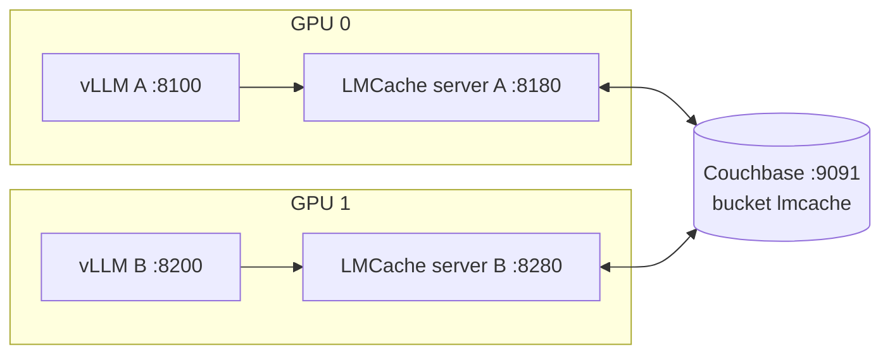

# Running the demo

This guide sets up, from a bare Linux machine, the demo recorded in
[`evidence/`](../evidence/README.md): two vLLM servers on two GPUs, each with
its own LMCache server, sharing one KV cache stored in Couchbase. It then runs
the same checks, benchmark and browser demo that produced the published
results and video.



Everything runs in Docker from [`docker/compose.yaml`](../docker/compose.yaml).
vLLM, LMCache, CUDA and the connector live inside the image; the host only
needs Docker, GPU access for Docker, and Python 3 for the scripts.

## 1. Requirements

| | Used for the evidence | Minimum |
| --- | --- | --- |
| GPUs | 2× NVIDIA RTX 3090 (24 GB) | 2 NVIDIA GPUs; 24 GB each for Qwen3-8B, a few GB each for the default Qwen3-0.6B |
| CPU / RAM | 24 cores, 121 GB | Enough RAM for both LMCache CPU caches plus Couchbase (about 50 GB with the 8B settings below) |
| Disk | | About 18 GB for both models plus the LMCache image and Couchbase data |
| OS | Ubuntu 26.10 | Linux with a recent NVIDIA driver (`nvidia-smi` works on the host) |
| Software | Docker Engine, Docker Compose v2, NVIDIA Container Toolkit 1.19, Python 3 | Same; Compose and the toolkit are covered below |

The scripts in `examples/` and `demo/server.py` use only the Python standard
library, so no virtualenv is needed to run them. Recording the clips needs
Playwright, Google Chrome and `ffmpeg` (section 7).

Keep the machine otherwise idle while measuring: Couchbase reads are
CPU-bound, and with the CPU saturated by other jobs, loading from Couchbase lost
to recomputing (see
[`ttft-…-host-cpu-saturated`](../evidence/ttft-20261026-183124-host-cpu-saturated/report.md)).

## 2. Give Docker access to the GPUs

Install the NVIDIA Container Toolkit. On Ubuntu it is in the archive:

```bash
sudo apt install -y nvidia-container-toolkit
```

On other distributions, follow NVIDIA's
[installation guide](https://docs.nvidia.com/datacenter/cloud-native/container-toolkit/latest/install-guide.html).

The compose file requests GPUs by their CDI name (`nvidia.com/gpu=0`), not
with `--gpus`, because Docker's `nvidia` device driver isn't configured unless
you also run `nvidia-ctk runtime configure`. Toolkit 1.17 and later generate
the CDI spec automatically (in `/var/run/cdi/nvidia.yaml`). Check that both
GPUs are listed, and generate the spec by hand if they are not:

```bash
nvidia-ctk cdi list            # expect nvidia.com/gpu=0, nvidia.com/gpu=1, nvidia.com/gpu=all
sudo nvidia-ctk cdi generate --output=/etc/cdi/nvidia.yaml   # only if the list is empty
```

Then check that a container can see them:

```bash
docker run --rm --device nvidia.com/gpu=all ubuntu:24.04 nvidia-smi -L
```

### Docker Compose

If `docker compose version` fails, install the Compose plugin. Your
distribution's `docker-compose-v2` / `docker-compose-plugin` package works, or,
without root, the release binary as a user-local plugin:

```bash
V=$(curl -fsSL https://api.github.com/repos/docker/compose/releases/latest \
  | python3 -c "import sys, json; print(json.load(sys.stdin)['tag_name'])")
mkdir -p ~/.docker/cli-plugins
curl -fsSL -o ~/.docker/cli-plugins/docker-compose \
  "https://github.com/docker/compose/releases/download/$V/docker-compose-linux-x86_64"
chmod +x ~/.docker/cli-plugins/docker-compose
docker compose version
```

## 3. Start the stack

```bash
git clone https://github.com/Couchbase-Ecosystem/couchbase-lm-cache
cd couchbase-lm-cache
```

The defaults run the small Qwen3-0.6B model with small caches, which is enough
to check that everything works. The published results used Qwen3-8B, where
loading from Couchbase is clearly faster than recomputing. Export the settings
in the shell you'll run everything from, because the scripts recreate
containers and need the same values:

```bash
# Qwen3-8B, as in evidence/. Leave these unset for the Qwen3-0.6B defaults.
export MODEL=Qwen/Qwen3-8B GPU_MEMORY_UTILIZATION=0.85 LMCACHE_L1_SIZE_GB=16
export COUCHBASE_RAM_MB=18432 COUCHBASE_BUCKET_RAM_MB=16384

docker compose -f docker/compose.yaml up -d --build
```

| Variable | Default | 8B demo | Purpose |
| --- | --- | --- | --- |
| `MODEL` | `Qwen/Qwen3-0.6B` | `Qwen/Qwen3-8B` | Model served by both vLLM servers |
| `GPU_MEMORY_UTILIZATION` | `0.2` | `0.85` | vLLM's share of each GPU (weights plus its own KV cache) |
| `LMCACHE_L1_SIZE_GB` | `4` | `16` | Each LMCache server's CPU cache, in front of Couchbase |
| `COUCHBASE_RAM_MB` | `4096` | `18432` | Couchbase node memory quota |
| `COUCHBASE_BUCKET_RAM_MB` | `3072` | `16384` | `lmcache` bucket quota; size it to hold the KV cache you want served from memory |

What happens on the first start:

1. The image `couchbase-lm-cache/vllm-lmcache:0.5.6` is built from
   [`docker/Dockerfile`](../docker/Dockerfile): the official
   `lmcache/vllm-openai:v0.5.6` image (LMCache 0.5.6, vLLM 0.31.0) plus this
   package. The base image download is the slow part.
2. Couchbase Server 8.0.2 starts, and `couchbase-init` runs
   [`docker/couchbase-init.sh`](../docker/couchbase-init.sh) once: it
   initializes the node (`Administrator` / `password`) and creates the
   `lmcache` bucket, then exits.
3. Each LMCache server starts in multiprocess mode with the Couchbase L2
   adapter, and each vLLM server connects to it through `LMCacheMPConnector`.
4. vLLM downloads the model into the `couchbase-lmcache-hf-cache` volume (about
   16 GB for Qwen3-8B) and loads it. This takes a few minutes the first time.

Wait until everything is healthy:

```bash
docker compose -f docker/compose.yaml ps        # vllm-a and vllm-b "healthy", couchbase-init "exited (0)"
curl -fs localhost:8100/health && curl -fs localhost:8200/health && echo ready
```

| URL | What |
| --- | --- |
| http://localhost:9091 | Couchbase web console (`Administrator` / `password`) |
| http://localhost:8100, http://localhost:8200 | vLLM A and B (OpenAI-compatible API) |
| http://localhost:8180, http://localhost:8280 | LMCache servers A and B (HTTP API) |

To watch the connector at work, follow the LMCache logs in another terminal:

```bash
docker compose -f docker/compose.yaml logs -f lmcache-a lmcache-b | grep -i couchbase
```

## 4. Check it end to end

```bash
python3 examples/vllm_e2e_demo.py
```

[`examples/vllm_e2e_demo.py`](../examples/vllm_e2e_demo.py) runs three trials.
Each sends a long, never-seen prompt (a generated ledger with one hidden access
code, so every answer can be checked):

1. to vLLM A, which computes it while LMCache A stores the KV cache in
   Couchbase;
2. to vLLM B, which has never seen it and loads it from Couchbase;
3. a fresh prompt to vLLM B, computed, as the baseline.

Then it recreates LMCache A and vLLM A, which wipes their GPU and CPU caches,
and asks again, so the KV cache can only come from Couchbase. Results go to
`evidence/e2e-<timestamp>/` (`report.md`, `results.json`): time to first
token (TTFT) of every step, the answers, first-token log-probabilities,
LMCache log lines and the bucket's document count.

Useful options: `--trials`, `--skip-restart`, `--facts` (prompt length).

## 5. Measure a restart

```bash
python3 examples/ttft_benchmark.py --prompts 5
```

[`examples/ttft_benchmark.py`](../examples/ttft_benchmark.py) uses pair B: it
sends five unique prompts cold, recreates LMCache B and vLLM B, sends one short
warm-up request, then sends the same five prompts (KV cache from Couchbase)
and five new ones (computed) on the same warmed-up server. With Qwen3-8B this
gave a median TTFT of 1.14 s from Couchbase vs. 2.69 s computed
([report](../evidence/ttft-20261026-191832/report.md)). The first one or two
loads after a restart are slower.

## 6. Browser demo

[`demo/`](../demo) is a live view of the same flow, the page in
`evidence/recordings/01-demo.mp4`:

```bash
python3 demo/server.py          # then open http://localhost:8711 and press Space
```

`demo/server.py` proxies real streaming requests to vLLM A and B and streams
the Couchbase bucket stats (polled every 500 ms) and LMCache log lines (from
`docker compose logs`) to the page. Nothing on the page is scripted. Pressing
Space (or opening `http://localhost:8711/?autoplay`) runs three requests, one
per column:

1. **Server A, document X:** LMCache finds `0 of 40 chunks` in Couchbase, the
   GPU computes the prompt and the KV cache is stored (about 2.7 s with 8B).
2. **Server B, document X:** it finds `40 of 40 chunks`, loads 1.5 GB from
   Couchbase and answers the same code (about 1.2 s).
3. **Server B, document Y:** a different document, computed (about 2.7 s).

The strip at the bottom is the bucket's live document count: 0 → 1,480 →
2,960 (one 10k-token prompt is 40 chunks of 36 shards plus a manifest each).

Document X and Y are generated when `demo/server.py` starts, so restart it for
new ones. For a run that starts from an empty bucket, as in the recording,
recreate the bucket and warm up both servers first:

```bash
docker exec couchbase-lmcache-couchbase-1 couchbase-cli bucket-delete \
  -c localhost -u Administrator -p password --bucket lmcache
docker compose -f docker/compose.yaml up -d --force-recreate couchbase-init
docker wait couchbase-lmcache-couchbase-init-1
for port in 8100 8200; do
  curl -s localhost:$port/v1/completions -H 'Content-Type: application/json' \
    -d "{\"model\": \"$MODEL\", \"prompt\": \"Warm-up: say hello.\", \"max_tokens\": 4}" >/dev/null
done
python3 demo/server.py
```

(With the 0.6B defaults, use `Qwen/Qwen3-0.6B` in place of `$MODEL`.)

### Look at the cache in Couchbase

In the console at http://localhost:9091, open **Buckets → lmcache →
Documents**. Each KV-cache chunk is a small JSON manifest such as
`{"lmcache_shards": 36, "bytes": 37748736}` plus 36 binary documents of 1 MiB
named `<key>::shard::<n>`. The [storage format](../README.md#storage-format)
is described in the README.

## 7. Record the clips

[`demo/record.py`](../demo/record.py) drives the page and the Couchbase
console in headless Chrome and saves 1080p clips plus `markers.json`
(timestamps of every request and first token, for editing):

```bash
python3 -m venv ~/.venvs/demo-record
~/.venvs/demo-record/bin/pip install playwright   # uses the installed Google Chrome; ffmpeg must be on PATH
# reset the bucket and start demo/server.py as in section 6, then:
~/.venvs/demo-record/bin/python demo/record.py --out evidence/recordings
```

It produces `01-demo.mp4` (the page), `02-couchbase-buckets.mp4` (the bucket
list over the same run) and `03-couchbase-documents.mp4` (a chunk's manifest
and shards). The narrated explainer that uses these clips is built in
[`video/`](../video/README.md).

## 8. Run the test suite against the stack

The integration tests run inside the same image against the live Couchbase
(no GPU needed):

```bash
docker run --rm --network couchbase-lmcache_default \
  -e LMCACHE_COUCHBASE_LIVE_TESTS=1 -e LMCACHE_COUCHBASE_CONNSTR=couchbase://couchbase \
  -e LMCACHE_COUCHBASE_USERNAME=Administrator -e LMCACHE_COUCHBASE_PASSWORD=password \
  -e LMCACHE_COUCHBASE_BUCKET=lmcache --entrypoint python \
  couchbase-lm-cache/vllm-lmcache:0.5.6 -m pytest -v tests
```

All 48 tests passed for the evidence
([output](../evidence/01-pytest-live-lmcache-couchbase.txt)).

## Troubleshooting

| Symptom | Cause and fix |
| --- | --- |
| `could not select device driver "nvidia"` | Something requested GPUs with `--gpus` / `deploy.resources`. The compose file uses CDI devices; use `--device nvidia.com/gpu=N` in your own `docker run` commands too. |
| `unresolvable CDI devices nvidia.com/gpu=0` | No CDI spec. Run `nvidia-ctk cdi list`, and `sudo nvidia-ctk cdi generate --output=/etc/cdi/nvidia.yaml` if it's empty. |
| vLLM exits with CUDA out of memory | Another process uses the GPU, or `GPU_MEMORY_UTILIZATION` is too high for it. Check `nvidia-smi`; 0.85 fits Qwen3-8B on a 24 GB card with nothing else on it. |
| Port 9091, 8100 or 8200 already in use | Another container uses it; stop it or change the published ports in `docker/compose.yaml`. |
| `0 of 40 chunks found` on server B | B asked before A finished storing. Wait until the bucket's document count stops growing, as the scripts do. |
| Loading from Couchbase is slower than computing | Expected with Qwen3-0.6B (computing 7k tokens takes 0.25 s). With 8B, check the CPU is idle (`uptime`) and the bucket isn't over its quota (the console shows resident ratio below 100%). |
| `couchbase-init` exits with an error | Usually the RAM quotas: `COUCHBASE_BUCKET_RAM_MB` must fit in `COUCHBASE_RAM_MB`, and the node quota must fit the machine. Read it with `docker compose -f docker/compose.yaml logs couchbase-init`. |

## Tear down

```bash
docker compose -f docker/compose.yaml down        # stop; keeps the downloaded models and Couchbase data
docker compose -f docker/compose.yaml down -v     # also deletes both volumes (models and cache)
docker rmi couchbase-lm-cache/vllm-lmcache:0.5.6 lmcache/vllm-openai:v0.5.6
```

If you installed the NVIDIA Container Toolkit only for this demo:

```bash
sudo apt remove -y nvidia-container-toolkit nvidia-container-toolkit-base \
  libnvidia-container-tools libnvidia-container1
```
